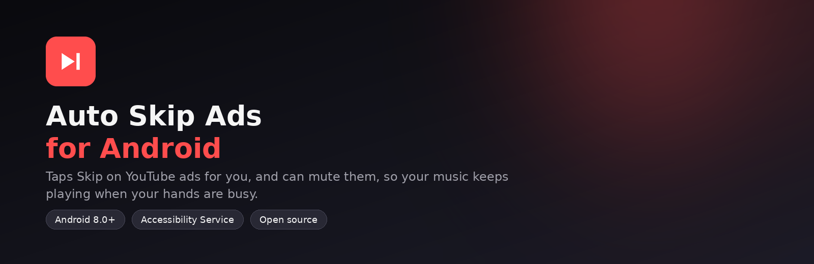

<p align="center">
  
</p>

# Auto Skip Ads for Android

> An Android app that taps the **Skip** button for you when a YouTube or YouTube Music ad shows one, and can mute ads, so your music keeps playing when your hands are busy.

[](https://github.com/Piyush27080/auto-skip-ads-android/actions/workflows/build-apk.yml)


This is the Android companion of my Chrome extension, [Auto Skip Ads for YouTube](https://github.com/Piyush27080/auto-skip-ads-extension).

## Screenshots

<!-- Take screenshots of the app on your phone, save them in docs/screenshots/ and uncomment: -->
<!-- <p align="center"></p> -->

## Features

- **Taps Skip automatically:** the moment the Skip button appears, whether that is after 5, 10 or 15 seconds
- **Mute ads:** silences the music volume while an ad is on screen and restores it afterwards
- **Stats:** counts the ads it skipped and shows an estimate of the time saved
- **ON/OFF switch** and **Reset stats**, like the Chrome extension
- **Fast-forward ads (experimental):** tries to move the ad's progress bar to the end for ads with no Skip button. It does not work on every phone
- **Works with** the YouTube and YouTube Music apps
- **Private by design:** no internet permission, no tracking, no accounts

## Download and install

1. Open the **[latest release](https://github.com/Piyush27080/auto-skip-ads-android/releases/latest)** and download `AutoSkipAds-vX.Y.Z.apk` to your phone.
2. Open the file. When Android asks, allow **Install unknown apps** for the app you opened it from. If Google Play Protect shows a warning, choose **More details → Install anyway**.
3. Open **Auto Skip Ads** and tap **Open Accessibility settings**.
4. Find **Auto Skip Ads** under *Downloaded apps* or *Installed apps*, turn it on, and confirm.
5. On Android 13 and newer, if the switch is greyed out: **Settings → Apps → Auto Skip Ads → ⋮ (top right) → Allow restricted settings**, then repeat step 4.
6. Back in the app, the status should say **Active**. Open YouTube and watch.

> The APK is signed with a debug key that is the same for every release, so you can install a new version over the old one. Your settings and stats are kept.

## Using the app

| Control | What it does |
|---|---|
| **ON/OFF switch** (top right) | Pauses or resumes the app without turning the Accessibility service off |
| **Ads skipped** | Counted when the Skip button disappears after the app tapped it |
| **Time saved** | An estimate: the part of the ad that was left when it was skipped. It shows 0 for an ad whose length could not be read |
| **Mute ads** | Mutes the media volume while an ad is on screen, then restores it |
| **Fast-forward ads** | Experimental, off by default |
| **Reset stats** | Sets both counters back to zero |
| **Save debug log** | For bug reports only. Records text from the YouTube screen, so keep it off otherwise |

## How it works

- The app is an Android **Accessibility Service**. Android lets such a service read the screen and tap buttons for the user. This one is limited to two apps, `com.google.android.youtube` and `com.google.android.apps.youtube.music`.
- It looks through the screen for the ad player layer and for a visible button called **Skip** (YouTube's `skip_ad_button`), then clicks it. If a normal click is refused, it touches the middle of the button with a tap gesture.
- While an ad layer is on screen, it can mute the music volume with `AudioManager`, and unmutes about 1.5 seconds after the ad is gone.

## Permissions and privacy

- **Accessibility service:** the only special permission. It is needed to see the Skip button and tap it.
- **No internet permission.** Nothing is sent anywhere.
- Stats and settings are stored only on your phone.
- The debug log is **off by default**. When on, it saves text from the YouTube screen inside the app, and you decide whether to share it.

## Troubleshooting

- **Status says "Service is off" or "Starting...":** turn the service off and on again in Accessibility settings.
- **Service keeps stopping (Xiaomi, Redmi, Oppo, Vivo and similar phones):** turn on **Autostart** for the app, set its battery option to **No restrictions**, and lock the app in the recent apps screen. Do not swipe it away.
- **Nothing is skipped:** the Skip button must be on the screen, and the screen must be on. Ads without a Skip button cannot be skipped.
- **Wrong or missing taps after a YouTube update:** turn on **Save debug log**, play an ad, tap **Share log**, and open an [issue](../../issues/new/choose) with it.

## Limitations

- The **screen must be on**. An Accessibility service cannot see a locked or turned-off screen.
- Ads with no Skip button cannot be skipped. Fast-forward may help on some phones, but it is experimental.
- YouTube changes its app often, so the button's name or position may change and the app may need an update.
- The app taps any visible button called "Skip" in the two YouTube apps, not only on ads.
- Google Play restricts apps that use the Accessibility API for purposes other than helping people with disabilities, so this app is shared here as an APK instead of on Google Play.

## Tested on

| Phone | Result |
|---|---|
| Oppo A5 2020, Android 10 | Skip tapping worked (earlier test build) |
| Redmi Note 5 Pro, MIUI | The service did not stay connected in my tests. Battery and autostart limits are the likely cause |

Version 1.0.0 is new, and I am still testing it on more phones. Tell me how it works on yours by opening an issue.

## Build it yourself

**In the cloud (no Android Studio needed):**
1. Push to `main`. GitHub Actions builds a debug APK, and you can download it from the run page under **Artifacts**.
2. To publish a version, create a Release with a tag such as `v1.0.0` (or push the tag). The workflow attaches the APK to the Release.

**On your computer:** open the project in Android Studio and click Run, or run `./gradlew assembleDebug`.

## Project structure

```
auto-skip-ads-android/
├── app/src/main/
│   ├── java/com/piyush27080/autoskipads/
│   │   ├── SkipService.kt     # the Accessibility Service: mute, tap Skip, stats
│   │   ├── MainActivity.kt    # the app screen
│   │   └── Prefs.kt           # saved settings and counters
│   ├── res/                   # layout, icon, theme, service configuration
│   └── AndroidManifest.xml
├── .github/workflows/build-apk.yml   # builds the APK and attaches it to Releases
├── ci/debug.keystore          # fixed debug signing key used by the build
├── docs/images/               # banner, icon and social preview
├── CHANGELOG.md
├── CONTRIBUTING.md
├── LICENSE
└── README.md
```

## Roadmap

- [x] Tap the Skip button automatically
- [x] Mute ads, stats, ON/OFF switch, app icon
- [ ] Test on more phones and YouTube versions
- [ ] Add real screenshots to this README
- [ ] Make "Fast-forward ads" reliable, or remove it if YouTube blocks it
- [ ] Hindi translation of the app

## Disclaimer

This is an **educational project**, not affiliated with, endorsed by, or connected to YouTube or Google. "YouTube" is a trademark of Google LLC. Skipping ads may go against YouTube's Terms of Service. Use it at your own risk and responsibility.

## Contributing

Bug reports and pull requests are welcome. See [CONTRIBUTING.md](CONTRIBUTING.md).

## License

Released under the [MIT License](LICENSE).

## Author

Made by **Piyush**. If this project helped you, consider giving it a ⭐ on GitHub.
